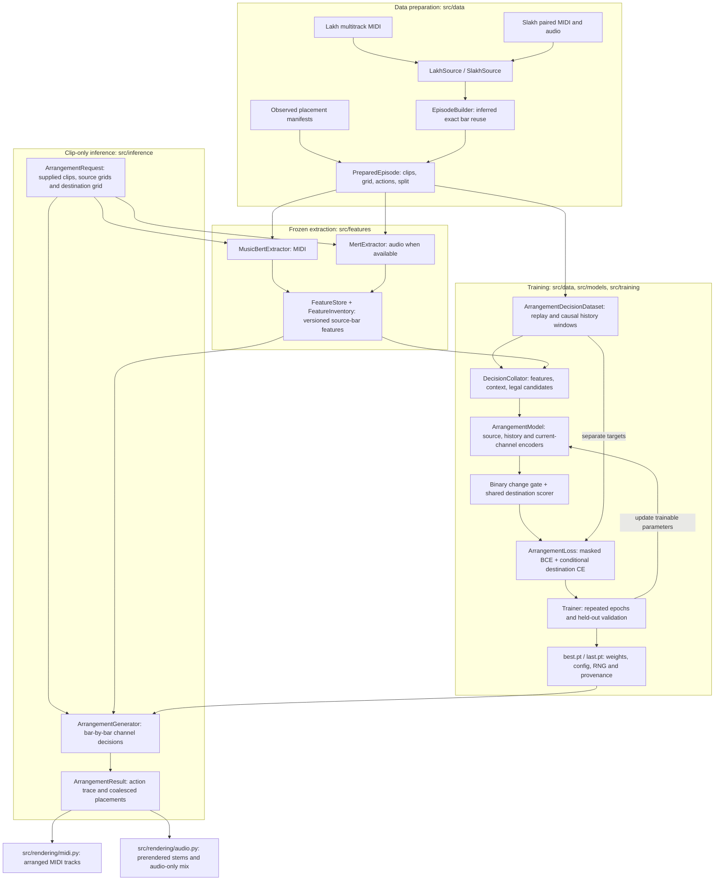
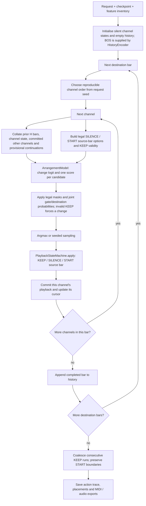

# Stem arranger

A bar-aligned arrangement policy over supplied clips. Each channel owns one variable-length MIDI or audio clip. At every destination bar the model decides whether to keep the channel's natural playback or change it; a shared destination scorer selects silence or a source bar to restart from.

This generates placements, crops and repetitions of existing material. It does not generate new notes or audio. No full songs are required at inference.

## Model



Feature extraction runs before training or generation. The generator loads the same `ArrangementModel` architecture and uses the same collator and playback rules as training. Source MIDI and audio may use different frozen extractors and feature widths; trainable projections bring them into the common model space.

The history transformer is causal. Current-bar context contains committed channels and explicitly provisional continuation for undecided channels. Candidate source content is available, but hidden current decisions and future arrangement targets are not inputs. Candidate scores depend on musical embeddings and positions, not learned clip IDs.

The change gate also receives a pooled summary of the channel's candidate material, including when the channel is silent. Optional `role` IDs are supplied metadata; the MIDI reader sets 1 for drums and 2 for bass, with 0 for unknown. Additional consistent IDs below 16 can represent lead, chords, pads or other roles in custom manifests. These are hints, not section labels inferred by a separate classifier.

The loss is masked binary cross-entropy for change decisions plus conditional destination cross-entropy on changes. Forced source-end decisions omit gate supervision. Joint action probabilities are used for decoding. Silence ends a playback run; re-entry chooses a source position explicitly. A silent channel can keep its silence.

Continuous summaries are the baseline. No new VAE/codebook, LLM or foundation-model pretraining is required. See [the implementation specification](IMPLEMENTATION_PLAN.md) for the broader design and deferred experiments.

## Environment

Use Python 3.11 or 3.12 in a clean environment with a compatible PyTorch installation:

```powershell
python -m venv .venv
.venv/Scripts/python -m pip install -e ".[dev,audio,midi]"
```

The native MIDI extra uses the pinned [MusicBERT Hugging Face port](https://github.com/malcolmsailor/musicbert_hf). Install only `.[dev]` for cached-feature training, tests and MIDI export; `.[audio]` adds MERT extraction. A broken pre-existing torchvision installation can break Transformers imports even though this project does not need torchvision; use a clean environment instead of modifying global packages.

## Data and pretrained weights

- [Lakh MIDI](https://colinraffel.com/projects/lmd/): download LMD-full and extract its MIDI tree locally. The loader reads separate parts from each file.
- [Slakh2100-redux](https://zenodo.org/records/4599666): aligned per-source MIDI and FLAC. Preserve the dataset directory structure; `omitted` is excluded. MIDI-derived composition groups determine our splits, not raw file counts. Audit near-duplicate compositions before reporting benchmark results.
- [MusicBERT](https://github.com/microsoft/muzic/tree/main/musicbert): obtain pretrained weights. Extraction accepts a Hugging Face MusicBERT checkpoint directory/model ID. Convert original fairseq `.pt` files once with the command below.
- [MERT-95M](https://huggingface.co/m-a-p/MERT-v1-95M): the audio extraction command downloads the checkpoint or accepts a local snapshot. The checkpoint's published license is CC BY-NC 4.0; dataset/instrument rights remain separate from code licensing.

Downloaded data and weights are not committed. Frozen extractor outputs are cached independently from the trainable projections, with content/preprocessing/revision keys.

```powershell
python -m src.cli.convert_musicbert --checkpoint D:/models/musicbert_base.pt --output D:/models/musicbert-hf --trusted-checkpoint
```

The conversion command uses the pinned port's weight mapping; the trust flag acknowledges legacy fairseq pickle loading. Use original weights from a trusted source. No random encoder is substituted when weights are absent.

## Prepare MIDI training examples

```powershell
python -m src.cli.prepare --source lakh --root D:/datasets/lmd_full --output data/episodes.json --limit 100
python -m src.cli.extract --episodes data/episodes.json --modality midi --midi-checkpoint D:/models/musicbert-hf --cache data/features --output data/midi_inventory.json
python -m src.cli.train --episodes data/episodes.json --inventory data/midi_inventory.json --model-config configs/model.yaml --config configs/train_midi.yaml --output checkpoints/midi
```

`--limit` counts accepted compositions. Preparation writes a report of exclusions. Train and validation splits must both contain usable compositions; the loader refuses empty training/validation datasets. Feature widths are read from the inventory; model width, heads and history come from the model configuration.

The automatic preparation baseline mines exact reusable source bars and their occurrences from multitrack MIDI. It currently accepts constant tempo and notes contained within bar boundaries. It preserves MIDI controller state and excludes pitch bends/program changes it cannot faithfully support. Inference and observed-manifest export support notes sustaining across bar boundaries, but this exact-bar miner deliberately does not fabricate recurrence labels for them.

These are **inferred reuse labels**, not recovered producer edits. A rest is not proof of a muted DAW clip. For genuine crop/repeat annotations, supply observed episodes using the typed JSON schema and validate them with `--source observed --root <episodes.json>`. Artificial fixtures are labelled `constructed_fixture` and used only for mechanical checks.

## Paired audio and mixed training

```powershell
python -m src.cli.prepare --source slakh --root D:/datasets/slakh2100_flac_redux --output data/slakh_episodes.json
python -m src.cli.extract --episodes data/slakh_episodes.json --modality both --midi-checkpoint D:/models/musicbert-hf --cache data/features --output data/paired_inventory.json
python -m src.cli.train --episodes data/slakh_episodes.json --inventory data/paired_inventory.json --initialise checkpoints/midi/best.pt --mix-modalities --config configs/train_midi.yaml --output checkpoints/mixed
```

Paired modalities remain one clip, not two competing candidates. `--mix-modalities` chooses a reproducible modality for each channel/episode/epoch. The audio branch must actually be trained before generating audio requests: an untrained branch is rejected by the generation CLI. This is synthetic-render adaptation; competent performance on real recorded audio still needs real-audio training/evaluation and appropriate labels.

`--resume checkpoints/midi/last.pt` resumes an interrupted run with optimiser/RNG state and validates dataset/extractor provenance. `--initialise` starts a new adaptation experiment from model weights without pretending it is the same dataset/run.

Resume permits changing the final epoch count and device while requiring the remaining training options to match. Adaptation retains the previously trained modality declarations and extractor revisions.

## Arrange new clips



The model scores source bars within the current channel's supplied clip. There is no search over all stem combinations and no selection of random codebook entries. Choosing a source bar restarts from that position; successive KEEP decisions determine the crop's duration. Later START decisions can replay the same source material.

Create a MIDI-only request, or combine `--midi` and `--audio` arguments:

```powershell
python -m src.cli.request --midi clips/keys.mid --midi clips/drums.mid --bpm 120 --bars 32 --output data/request.json
python -m src.cli.extract --request data/request.json --midi-checkpoint D:/models/musicbert-hf --cache data/features --output data/request_inventory.json
python -m src.cli.generate --checkpoint checkpoints/midi/best.pt --request data/request.json --inventory data/request_inventory.json --output runs/arrangement
```

Audio request creation requires complete source bars at the declared tempo and `--audio-starts-on-downbeat`. For irregular timing, build an explicit source grid in the request manifest. Version 1 masks incompatible source/destination meters and audio durations; it does not silently time-stretch or transpose clips.

Generation writes an inspectable `arrangement.json` and separate MIDI tracks in `arrangement.mid`. Add `--render-audio` to export prerendered audio channels and their audio-only mix. MIDI instrument synthesis is a separate renderer; MIDI is not converted to audio just to score it. Use `--sample --temperature 0.8` for reproducible joint-action sampling instead of argmax.

Consecutive KEEP decisions coalesce into continuous source spans. START boundaries remain explicit even when adjacent material sounds identical. Entering MIDI sustains are retriggered at crop entry; true crop ends release/clamp notes. Audio fades are applied at actual cuts, not every internal KEEP boundary.

## Evaluation and checks

```powershell
python -m src.cli.evaluate --episodes data/episodes.json --inventory data/midi_inventory.json --checkpoint checkpoints/midi/best.pt --split test --output runs/evaluation.json
python -m pytest
python -m ruff check src tests main.py inference.py
python -m ruff format --check src tests main.py inference.py
python -m mypy
```

Evaluation reports teacher-forced decisions, generated rollout behaviour and a fixed-loop baseline. Exact inferred-action accuracy measures the prepared task; it is not alone evidence of musical quality. Use held-out composition groups and listen to full rollouts.

The regular test suite uses deterministic small feature fixtures, explicitly not pretrained representations. Optional adapter checks:

```powershell
$env:RUN_EXTRACTOR_TESTS = "1"  # native adapter with a tiny local test model
$env:RUN_MERT_SMOKE = "1"      # real downloaded MERT weights and supplied audio sample
python -m pytest tests/test_extractors.py
```

## Organisation and migration

- `src/contracts.py`, `src/timing.py`: musical data and coordinates.
- `src/data/`: source adapters, episode construction, replay, batching and JSON.
- `src/features/`: frozen pretrained adapters and versioned caches.
- `src/models/`: temporal/set/history encoders, gate/scorer and masked losses.
- `src/training/`: training, checkpointing, evaluation and baselines.
- `src/inference/`: shared playback transitions, legal choices and generation.
- `src/rendering/`: MIDI and prerendered audio export.
- `src/cli/`: thin command-line entry points.

The previous 25-dimensional mixed-bar VQ pipeline and random bundle retrieval were removed. Its checkpoints are incompatible. `main.py` and `inference.py` forward to the new train/generate commands. The new finite map-style loader supports repeated epochs, replacing the old one-shot streaming iterator. Older documents under `docs/` describe the previous architecture; this README is the executable workflow.
